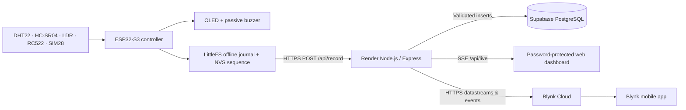
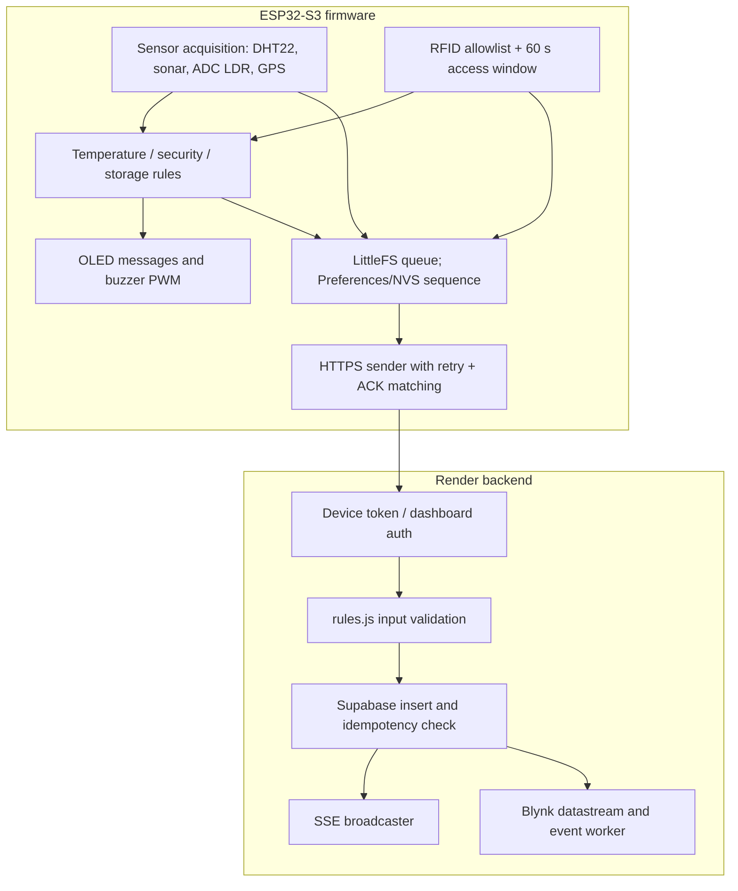
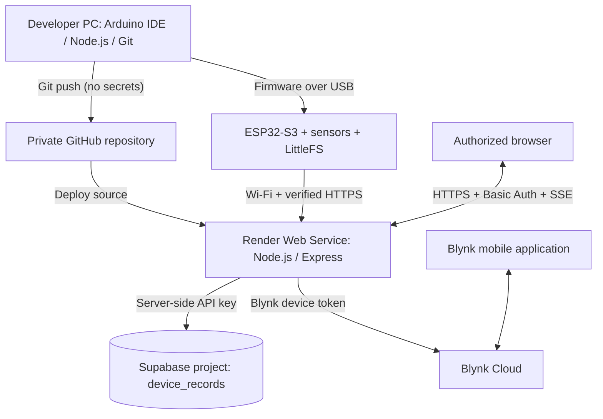
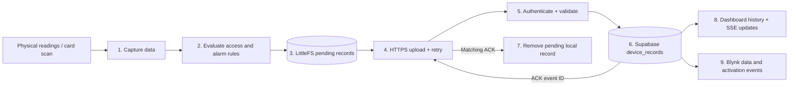

# SmartCold Guard — Technical Documentation

**Project:** ESP32-S3 IoT Cold-Storage Monitoring and Security System  
**Document type:** Technical report, architecture, testing evidence and developer deployment guide  
**Document status:** Working prototype; some integration and performance tests remain pending  
**Revision:** 23 November 2026  
**Intended use:** University demonstration, **not** a certified cold-chain or access-control product

## 1. Project Overview

SmartCold Guard is an Internet of Things (IoT) prototype that monitors a storage enclosure and records environmental, location and access-related information. The **ESP32-S3** reads temperature and relative humidity from a DHT22, distance from an HC-SR04 ultrasonic sensor, incident light from an LDR, RFID card UIDs from an RC522 reader, and satellite information from a Grove SIM28 GPS receiver. An OLED displays RFID authorization results and a transistor-driven passive buzzer provides a local alarm. **There is no motor or automated lock** in this prototype.

The device creates local event records and uploads them via **HTTPS** to a Node.js/Express backend hosted on Render. The backend validates and stores the records in Supabase PostgreSQL, updates the web dashboard, and relays datastreams and alert events to Blynk IoT. The dashboard presents live status, historical temperature/humidity measurements, RFID access logs, event history and GPS location when a fix is available.

A LittleFS journal on the ESP32 buffers records during network/database interruptions. After a successful cloud acknowledgement the corresponding local record is removed. This is a **finite offline queue**, not unlimited local storage or a full relational database.

### 1.1 Demonstration scenarios

- **High temperature:** a measured temperature strictly **above 23.5°C** generates a local buzzer alarm and a stored `high_temp` activation event; the backend can relay a Blynk push event and show the alarm on the web dashboard.
- **Unauthorized access:** if there is no active authorized RFID session, **either** distance strictly **above 30 cm** **or** LDR raw value strictly **above 350** can trigger the security alarm. Distance and light are independent indicators: a door can open in a dark room, and unexpected light can be detected with the door classified as closed.
- **Authorized RFID:** a recognized card starts a **60-second window** in which an opening may begin. Once an authorized opening begins, access remains granted until the door is detected closed. Every scan, including unauthorized scans, is logged with a time and GPS coordinates **only if available**. UID-based authorization is a demonstration technique, not secure identity verification.

The numerical thresholds are selected for a classroom demonstration without a refrigerator. They should not be described as medical-storage compliance limits.

## 2. Requirements

### 2.1 Functional requirements

| ID | Requirement | Implementation / acceptance condition |
|---|---|---|
| FR-01 | Monitor temperature and humidity | DHT22 measurements logged and displayed with history |
| FR-02 | Detect opening or unexpected light | HC-SR04 distance >30 cm **OR** LDR >350 |
| FR-03 | Identify RFID authorization | Allowlist evaluated locally; OLED shows authorized/unauthorized |
| FR-04 | Generate local alarms | Buzzer ON when temperature alarm, security alarm, or storage fault is active |
| FR-05 | Send mobile alerts | Render triggers Blynk events `high_temp` and `unauthorized_open` on alarm activation |
| FR-06 | Record RFID audit trail | UID, authorization result, timestamp, and GPS when valid |
| FR-07 | Retain offline data | LittleFS journal persists pending records for later replay |
| FR-08 | Prevent duplicate cloud records | Unique device/event IDs with matching server acknowledgements |
| FR-09 | Show live device status | SSE (`/api/live`) pushes new accepted records to the dashboard |
| FR-10 | Preserve history | Supabase stores sensor, RFID, door and alarm records |

### 2.2 Non-functional requirements and limitations

| Area | Requirement or limitation |
|---|---|
| Communication security | ESP32 validates HTTPS certificates; private device token authenticates uploads |
| Browser access | HTTP Basic Authentication protects `/dashboard` and API read/live endpoints |
| Data protection | Supabase secret stays server-side in Render environment variables; RLS enabled on the new table |
| Sample rate | Scheduled readings every **5 seconds**; RFID checks also occur in the main loop |
| Live behavior | Browser SSE updates **after Supabase accepts a record**; not continuous subsecond telemetry |
| Mobile latency | Blynk datastream updates are rate-limited in the backend, nominally **15 seconds**; notification delivery is service-dependent |
| Storage capacity | ESP32 flash is finite; queue exhaustion generates a storage fault, not guaranteed unlimited retention |
| Power resilience | Sudden power loss, flash failure, or an offline cold boot without valid time can reduce record completeness |
| Location availability | GPS location is recorded as `null` when no current fix exists; indoor reception is not guaranteed |

### 2.3 Hardware and pin assignment

| Component | Interface | ESP32-S3 pins / notes |
|---|---|---|
| DHT22 | Digital | DATA GPIO4 |
| HC-SR04 | Digital | TRIG GPIO5; ECHO GPIO6 **through 1 kΩ / 2 kΩ divider**; supply as wired/tested |
| LDR + 10 kΩ resistor | ADC voltage divider | GPIO1, 3V3 and GND |
| RC522 RFID | SPI | SDA/SS GPIO10; MOSI GPIO11; SCK GPIO12; MISO GPIO13; RST GPIO14 |
| Grove SIM28 GPS | UART | GPS TX → ESP32 GPIO17; GPS RX ← ESP32 GPIO16 |
| OLED SSD1306 | I²C | SDA GPIO8; SCL GPIO9; 3V3/GND; I²C configuration |
| Passive buzzer | PWM via transistor driver | GPIO2 drives a resistor/transistor circuit; **not directly powered by GPIO** |

Before reproducing the hardware, verify the exact buzzer supply requirements, transistor pinout and wiring. The tested prototype connection does not substitute for component datasheets or a safety inspection.

## 3. Architecture

### 3.1 System architecture diagram



*Figure 1. End-to-end data path. An acknowledgement is returned only after the server accepts the database insert or recognizes a matching duplicate.*

### 3.2 Component diagram



*Figure 2. Firmware and backend responsibilities are separated so authentication, persistence, display and alerts can be tested independently.*

### 3.3 Deployment diagram



*Figure 3. Secrets are entered as Render environment variables; they must not be checked into GitHub.*

### 3.4 Data flow diagram



*Figure 4. A failed upload leaves the record in the local queue; only a matching acknowledged ID permits deletion.*

## 4. Technical Decisions

**ESP32-S3 as edge controller.** The ESP32 handles local sensing, card decisions, OLED output and buzzer activation without waiting for network access. This keeps local alarms possible during an outage.

**Independent door and light indicators.** The final security decision uses `(distance > 30 cm OR LDR > 350) AND NOT authorized`. The original integrated firmware download used an outdated **AND** condition for door status. A developer starting from that package must apply the two final security patches described in Section 7.6. Merely updating dashboard wording is not sufficient.

**Offline-first journal rather than continuous direct writes.** Each sensor sample or event is written to LittleFS and assigned a persistent sequence from NVS. The ESP32 sends the oldest pending record first. Only a server `ackId` matching its event ID authorizes local removal. The server has unique constraints on `(device_id,event_id)` and `(device_id,sequence)` to prevent identical retries from creating duplicate rows. This is designed for *at-least-once upload with idempotent storage*, not an absolute guarantee of never losing a record.

**Supabase JSONB event model.** `public.device_records` stores `device_id`, `event_id`, `sequence`, `record_type`, `occurred_at`, `received_at`, `payload`, `payload_digest`, `notification_code`, and `notification_sent`. Record types are `sensor`, `rfid`, `door`, and `alarm`. Earlier `sensor_readings` and `rfid_events` tables are retained for compatibility.

**Blynk as notification and live-status channel.** Render performs Blynk HTTPS updates (V0–V10) and triggers `high_temp` and `unauthorized_open` events on alarm activation. Supabase is the permanent audit store; Blynk is not treated as the authoritative history database. Blynk may suppress repeated notifications according to event limits and phone settings.

**SSE for web updates.** The latest backend has an authenticated `/api/live` EventSource stream. It pushes a newly accepted device record after the Supabase insert succeeds. The browser reconnects and falls back to polling when SSE is unavailable. The SSE implementation is in-process and intended for one Render service instance.

**UTC records, Finland-local presentation.** Record timestamps remain UTC. The dashboard formats them using `Europe/Helsinki`, so daylight-saving changes affect display only, not storage.

**Secure transport and access.** The ESP32 uses the board's built-in CA certificate bundle to validate HTTPS. The backend requires `X-Device-Token` for writes, HTTP Basic Authentication for dashboard/read endpoints, and server-only Supabase/Blynk secrets. RFID UID allowlisting is insufficient for production access security. No controlled physical lock is present.

## 5. Testing Strategy and Evidence

The distinction between **observed** results, **automated tests** and **still-pending** validation is essential. Numbers below are taken from project console results and available source tests; they are not performance estimates.

### 5.1 Recorded test evidence

| Test ID | Test | Evidence from development | Outcome / status |
|---|---|---|---|
| UT-01 | Backend record-validation unit suite | `node --test tests/rules.test.js`: **8 tests passed, 0 failed** (re-run 23 Nov 2026) | Pass for tested validation functions |
| COMP-01 | Arduino firmware compilation | **1,215,816 / 1,310,720 bytes program (92%)**; **50,424 / 327,680 bytes RAM (15%)** | Compiled; headroom is limited |
| SEN-01 | LDR response | Measured **1802 bright** and **392 dark** during hardware test | Pass: responds to changing light |
| SEN-02 | Ultrasonic closed-door reading | Repeated **28.1–28.5 cm** with enclosure closed; fixed flat target stable | Pass for fixed target; intermittent no-echo observed in some positions |
| GPS-01 | GPS fix and database storage | Serial output showed `hasFix:true`, **4 satellites**, and `POST /api/sensor-data => HTTP 200`; SQL screenshot showed rows with `gps_has_fix=true` | Pass at tested location; indoor performance variable |
| NET-01 | HTTPS telemetry | Serial `POST /api/sensor-data => HTTP 200`; later final firmware `Cloud saved and ACKed: ...` | Pass for observed sends and acknowledgements |
| DB-01 | Final database table | Supabase query returned `device_records` | Table created |
| LFS-01 | Local filesystem startup | First boot reported `LittleFS/NVS failed`; after one-time first-install initialization the user reported working operation | Recovery reported; offline durability not exhaustively tested |
| BLYNK-01 | Blynk backend configuration | `/api/status` returned `blynkConfigured: true`; 11 datastreams and two events configured | Configuration confirmed; end-to-end notification reliability **not proven** |
| SSE-01 | SSE backend implementation | Latest `server.js` passed `node --check`; `/api/live` endpoint exists | Syntax pass; live browser timing **not measured** |
| SEC-01 | Revised OR security condition | User identified old AND behavior; corrected OR rule documented and patched | Rule change specified; full end-to-end regression results not supplied |

The GPS coordinates were observed and stored, but should be masked in a public-facing report unless explicit consent is given to publish the location. Screen captures and console logs may be attached as an appendix when available.

### 5.2 Unit tests (automated)

The supplied Node.js suite covers valid sensor/RFID/GPS records, rejection of fabricated coordinates during no-fix, rejection of invalid record IDs and authorization values, notification selection for active alarms only, and timestamp preservation in UI conversion.

```bash
npm install
npm test
node --check server.js
```

**What it does not prove:** actual Supabase permissions, LittleFS flash behavior, concurrent connections, Blynk push delivery, GNSS signal quality or physical buzzer wiring.

### 5.3 Integration and validation tests to run before submission

| Test | Procedure | Expected observable evidence | Status |
|---|---|---|---|
| IT-01 | Temperature >23.5°C | Buzzer ON, dashboard high-temp, saved alarm activation, Blynk event | Needs a recorded three-channel test |
| IT-02 | Unauthorized door open in darkness | Distance >30, LDR ≤350, no permission → security alarm ON | Needs regression test of **OR** rule |
| IT-03 | Unauthorized light with door closed | Distance ≤30, LDR >350, no permission → security alarm ON | Needs regression test of **OR** rule |
| IT-04 | Authorized opening | Registered RFID followed by opening in window → no security alert; RFID logged | Needs timed test evidence |
| IT-05 | Unauthorized RFID | Unknown UID → `UNAUTHORIZED` on OLED, record saved with authorization status | Needs log/screenshots |
| IT-06 | Offline queue and replay | Turn off Wi-Fi, collect samples/scans, reconnect, compare stored sequences | Needs exact counts and oldest/newest times |
| IT-07 | Live dashboard | Check browser Network `/api/live`; confirm new record appears without refresh | Needs timestamped live demonstration |
| IT-08 | Blynk push | Clear prior alarm, retrigger after notification limit period, inspect event timeline and phone | Needs delivered notification evidence |
| SEC-02 | Bad device token | POST protected route with wrong token → HTTP 401 | Not yet documented as executed |
| SEC-03 | Dashboard authentication | Unauthenticated read/live API → HTTP 401 | Not yet documented as executed |
| PERF-01 | End-to-end delay | Record device, Supabase, browser and Blynk timestamps across 20 events | **No measured latency data yet** |

### 5.4 Security and performance assessment

Protect transport with HTTPS and token validation; keep `.env`, `Password.txt`, and credential-filled sketches out of version control. A GitHub push was blocked by secret scanning during development, so all leaked keys should be rotated before final submission. Supabase RLS and privileged server-side access reduce direct browser exposure, but do not make the demo tamper-proof. RFID UID cloning remains possible. Review notification delivery limits, GPS location privacy, and retained logs.

Expected update cadence from the code: **5-second sensor sampling**, SSE push after database acceptance, and nominal **15-second Blynk datastream updates**. These are configured intervals, **not measured end-to-end latency or availability guarantees**. Network outages and Render service pauses can delay cloud updates; local alarms still run.

## 6. Data Storage and API Reference

### 6.1 Cloud record structure

The final firmware sends one JSON record to **`POST /api/record`** for each sensor sample or event. Core fields include `id`, `deviceId`, `sequence`, `kind`, `occurredAt`, `uptimeMs`, sensor values, `gps`, `doorOpen`, `accessGranted`, `temperatureAlarm`, `securityAlarm`, `buzzerActive`, and `storageFault`. RFID records additionally contain `uid` and `authorization`; alarm records contain an event `code` and `active` state.

The REST backend also exposes:

| Route | Purpose | Access |
|---|---|---|
| `GET /api/status` | Basic deployment/configuration status; not proof of live connectivity | Public status |
| `POST /api/record` | Final idempotent device ingestion; responds with `ackId` | `X-Device-Token` |
| `GET /api/live` | Server-Sent Events stream of saved records | Dashboard Basic Auth |
| `GET /api/latest` | Latest stored reading | Dashboard Basic Auth |
| `GET /api/history?limit=200` | Historical sensor records | Dashboard Basic Auth |
| `GET /api/rfid-events` | RFID audit history | Dashboard Basic Auth |
| `GET /api/events` | Door/alarm event history | Dashboard Basic Auth |
| `GET /dashboard` | Live dashboard page | Dashboard Basic Auth |
| `POST /api/sensor-data`, `POST /api/rfid-event` | Legacy migration routes | Device token |

### 6.2 Example audit queries

```bash
-- Newest sensor data
SELECT sequence, occurred_at, received_at,
       payload->>'temperatureC' AS temperature_c,
       payload->>'humidityPercent' AS humidity_pct
FROM public.device_records
WHERE record_type = 'sensor'
ORDER BY sequence DESC LIMIT 20;

-- RFID access audit (GPS null when unavailable)
SELECT occurred_at, received_at,
       payload->>'uid' AS uid,
       payload->>'authorization' AS authorization,
       payload->'gps'->>'latitude' AS latitude,
       payload->'gps'->>'longitude' AS longitude
FROM public.device_records
WHERE record_type = 'rfid'
ORDER BY sequence DESC LIMIT 20;

-- Pending mobile notifications
SELECT event_id, notification_code, notification_sent
FROM public.device_records
WHERE notification_code IS NOT NULL
ORDER BY received_at DESC LIMIT 20;
```

## 7. Deployment Instructions for a New Developer

### 7.1 Prerequisites

You need an ESP32-S3 with the connected sensors/OLED/driver, Arduino IDE 2.x with an Espressif ESP32 core that supports `useBuiltinCACertBundle()`, the libraries listed below, Node.js **20 or newer**, Git access to the private repository, and access to a Render service, Supabase project and optional Blynk account. A 2.4 GHz-compatible Wi-Fi network and suitable antenna reception are needed for live cloud/GPS tests.

Use the **latest patched firmware**, rather than blindly replacing a working sketch with the unpatched initial ZIP.

### 7.2 Repository layout

```bash
IoT_project_2/
├── server.js                      # SSE-enabled Render backend
├── dashboard.html                 # browser UI, Finland time formatting
├── rules.js                       # record validation and conversion
├── package.json                   # npm start / npm test
├── schema_upgrade.sql             # additive Supabase migration
├── tests/rules.test.js            # 8 backend unit tests
├── .gitignore                     # ignore secrets and dependencies
└── SmartColdGuard_Final/
    └── SmartColdGuard_Final.ino    # local credentials only; never push secrets
```

The earlier integrated ZIP contains core backend and tests; the later SSE update provides replacement `server.js` and `dashboard.html`. Merge these with any subsequent patches before deployment.

### 7.3 Database setup

1. Create or select a Supabase project.
2. Run `schema_upgrade.sql` in Supabase SQL Editor. It creates the `public.device_records` table, indexes, RLS and service-role grants without dropping legacy tables.
3. Confirm the table exists:

```bash
SELECT to_regclass('public.device_records') AS table_name;
```

4. Keep Supabase **secret/service-role keys on the server only**. Do not add public database grants to make the dashboard work.

### 7.4 Local backend setup

Create a private `.env` at the repository root (never commit this file):

```bash
NODE_ENV=development
PORT=3000
SUPABASE_URL=https://YOUR_PROJECT.supabase.co
SUPABASE_SECRET_KEY=YOUR_CURRENT_ROTATED_SECRET
DEVICE_TOKEN=YOUR_CURRENT_RANDOM_DEVICE_TOKEN
DEVICE_ID=esp32-s3-01
DASHBOARD_USERNAME=demo
DASHBOARD_PASSWORD=SET_A_STRONG_PASSWORD
BLYNK_AUTH_TOKEN=YOUR_PRIVATE_BLYNK_DEVICE_TOKEN
BLYNK_HOST=blynk.cloud
BLYNK_UPDATE_INTERVAL_MS=15000
```

On Windows Git Bash or a terminal:

```bash
npm install
npm test
npm start
```

Open `http://localhost:3000/api/status` and `http://localhost:3000/dashboard`. Authenticate using `DASHBOARD_USERNAME` / `DASHBOARD_PASSWORD`. The `blynkConfigured` flag only means a token is present, not that mobile messages are being delivered.

### 7.5 Production deployment to Render and Blynk

1. Push the **secret-free** repository to GitHub. Ignore `.env`, `.env.*`, `Password.txt`, `node_modules/`, and any firmware file containing live credentials. Rotate credentials previously exposed to chat/Git history.
2. Create/connect a Render **Web Service**, runtime Node. Set build command `npm install`, start command `npm start`, and configure variables from Section 7.4 using **Render → Environment**. `PORT` is normally supplied by Render.
3. Deploy. Verify `https://smartcold-guard.onrender.com/api/status`; confirm browser login at `/dashboard`.
4. In Blynk Console, create a **SmartCold Guard** template/device. Datastreams: V0 temperature (Double), V1 humidity (Double), V2 distance (Double), V3 LDR (Integer), V4 access state (String), V5 temperature alarm (Integer), V6 security alarm (Integer), V7 latitude (Double), V8 longitude (Double), V9 buzzer (Integer), V10 GPS fix (Integer).
5. Add Critical events with exact codes `high_temp` and `unauthorized_open`, enable push to Device Owner, and set notification limits appropriate to testing. Set the actual Blynk Device Auth Token in Render, not in firmware.
6. Update the Blynk mobile template dashboard widgets to read V0–V10. Creating datastreams alone does not automatically create the mobile widgets.

### 7.6 Firmware setup and final security-rule patch

Install: **Adafruit DHT sensor library + Adafruit Unified Sensor**, **MFRC522**, **TinyGPSPlus**, **U8g2**, and **ArduinoJson 7**. Select ESP32S3 Dev Module, USB CDC On Boot enabled, the correct COM port, 4 MB flash, and an app+filesystem partition compatible with the compiled sketch. Keep *Erase All Flash Before Upload* disabled once records exist.

Enter private Wi-Fi credentials and the **Render** device token only in the local `.ino`. Verify RFID UIDs, component wiring and the tested PN2222A buzzer driver. The 23.5°C threshold remains independent of access authorization.

**Critical patch:** the source archive `SmartColdGuard_Final_Integrated.zip` predates the later OR-rule correction. In `sampleAndRecord()`, inside `if (lastDistanceValid)`, set:

```bash
const bool newDoorOpen = lastDistance > DOOR_DISTANCE_CM;
```

In `reevaluateSecurity()`, replace the old `newAlarm` line with:

```bash
const bool lightDetected = lastLight > 350;
const bool newAlarm = (doorOpen || lightDetected) && !accessGranted;
```

Keep the existing logic that clears authorized access when the door closes and that expires an unused authorization window after 60 seconds. This allows **unauthorized door opening in darkness** or **unexpected light with the door closed** to trigger an alarm. If distance is unavailable, it should be recorded as unknown, not silently assumed closed.

Compile using **Verify**, then upload. Confirm `LittleFS` mounts, records are written, and `Cloud saved and ACKed: ...` appears. **Do not blindly change `LittleFS.begin(false)` to `true`: formatting can destroy pending offline records.** A one-time format is reasonable only after explicitly verifying the filesystem has no records to preserve.

### 7.7 End-to-end verification and handover

1. Confirm sensor values in Serial Monitor and `POST /api/record` ACKs.
2. Confirm Supabase `device_records` contains newest sensor records and RFID logs.
3. Open the dashboard, inspect live status and an active `/api/live` EventSource connection; verify time display in Europe/Helsinki.
4. Scan an authorized card, then an unauthorized card, and compare OLED text, Supabase rows and access behavior.
5. Trigger temperature and both unauthorized-security scenarios; confirm buzzer, dashboard, Supabase events and Blynk event timeline/phone push.
6. Disconnect Wi-Fi, create several records, reconnect, and confirm exact queued sequences appear in Supabase without duplicates.
7. Archive screenshots of Serial Monitor, Supabase SQL results, Blynk event timeline, dashboard and Render logs with dates. Redact secrets and precise coordinates if the report will be public.

## 8. Conclusions

SmartCold Guard demonstrates an end-to-end IoT monitoring and access-audit workflow: sensing and local decisions on ESP32-S3, secure cloud ingestion on Render, persistent records in Supabase, a live web dashboard, and mobile notifications through Blynk. Development logs confirm sensor measurements, at least one valid GPS fix, successful HTTPS transfers, database storage and working alarm software. The included backend validation suite also passed eight automated unit tests.

The principal engineering improvement is the **offline-first journal with acknowledged replay**, which helps preserve measurements during temporary disconnections. However, the system does not guarantee unlimited or loss-free storage, instantaneous remote delivery, or production-grade access security. Full end-to-end notification, failure-recovery, security-negative and latency tests should be recorded before final assessment. Further development could add a larger storage medium, a hardware real-time clock and stronger RFID authentication.

## References and Evidence Sources

**Project source artifacts inspected:** `SmartColdGuard_Final_Integrated.zip` (firmware, `server.js`, `rules.js`, migration, tests), `SmartColdGuard_Realtime_SSE/server.js`, `SmartColdGuard_Realtime_SSE/dashboard.html`, and the subsequent door/light security corrections recorded during development. **The exact contents of the user's current GitHub repository were not independently fetched**, so deployment instructions include an explicit version check.

**Vendor documentation:**

- Render — Deploy Node Express: https://render.com/docs/deploy-node-express-app
- Render — Environment variables: https://render.com/docs/configure-environment-variables
- Supabase — Secure your API: https://supabase.com/docs/guides/api/securing-your-api
- Blynk — Datastreams: https://docs.blynk.io/en/blynk.console/devices/device-profile/developer-tools/datastreams
- Blynk — Notifications: https://docs.blynk.io/en/blynk.console/templates/events/events-notification-settings
- MDN — EventSource: https://developer.mozilla.org/en-US/docs/Web/API/EventSource

**Evidence to attach to the submitted report:** annotated images of the completed prototype, Arduino compilation output, final Serial Monitor alarm outputs, Supabase sensor/RFID queries, Blynk push/timeline, and the browser's live dashboard. Do not fabricate missing screenshots or test results.
